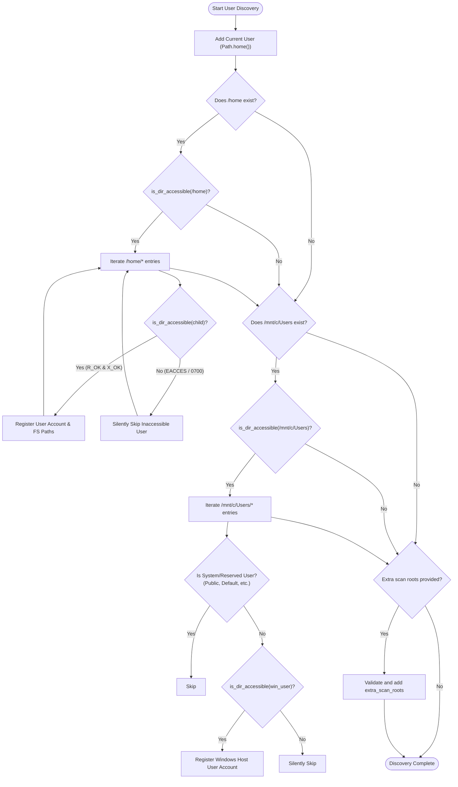

# Multi-User & Platform Discovery

Monitor Agent Usage natively supports multi-user environments, including multi-developer Linux workstations and Windows Subsystem for Linux (WSL) environments where agent logs exist on both the Linux root filesystem and the Windows host drive.

---

## Discovery Flow & Permission Safeguards

In multi-user Linux workstations, home directories (`/home/username`) typically have restrictive permissions (such as `0700` or `0750`). In Python 3.12+, calling `Path.exists()` or `Path.is_dir()` on child paths within restricted directories raises `PermissionError: [Errno 13] Permission denied`.

The engine implements strict pre-access validation to ensure that inaccessible directories are skipped silently without flooding terminal output with tracebacks.



---

## Permission Validation Architecture

### 1. `is_dir_accessible`
Before inspecting or registering any user path, the function performs a multi-stage accessibility check:

```python
def is_dir_accessible(p: Path) -> bool:
    """Return True if p is an existing directory accessible to current process."""
    try:
        if not p.is_dir():
            return False
        # 1. POSIX access check for Read and Traversal (Execute)
        if not os.access(p, os.R_OK | os.X_OK):
            return False
        # 2. Kernel scandir probe (validates ACLs, SELinux, and DrvFs mounts)
        with os.scandir(p) as _:
            pass
        return True
    except (OSError, PermissionError):
        return False
```

### 2. Safe Filesystem Wrappers (`collectors/base.py`)
Collectors never call raw `Path.exists()`, `Path.rglob()`, or `Path.read_text()` directly. Instead, they use safe wrappers:

- **`safe_exists(p)`**: Returns `False` on `PermissionError` or `OSError`.
- **`safe_is_dir(p)`**: Safely checks directory status without raising exceptions.
- **`safe_iterdir(p)`**: Returns an empty list if directory enumeration is denied.
- **`safe_rglob(base_dir, pattern)`**: Uses `os.walk(..., onerror=lambda _: None)` to recursively find files while gracefully bypassing restricted subdirectories or NTFS junction loops.
- **`safe_read_text(p)`**: Reads file contents with UTF-8 fallback, returning an empty string if permission is denied.

---

## WSL Windows Host Path Mapping

When running in WSL, Windows user profiles are located at `/mnt/c/Users/<username>`. The discovery engine maps both environments:

| Provider | Linux Path (`/home/<user>`) | Windows WSL Path (`/mnt/c/Users/<user>`) |
|---|---|---|
| **Antigravity** | `~/.gemini/antigravity` | `/mnt/c/Users/<user>/.gemini/antigravity` |
| **Claude Code** | `~/.claude` | `/mnt/c/Users/<user>/.claude` |
| **Claude Desktop** | `~/.config/Claude` | `/mnt/c/Users/<user>/AppData/Roaming/Claude` |
| **Codex** | `~/.codex` | `/mnt/c/Users/<user>/.codex` |
| **Grok** | `~/.grok` | `/mnt/c/Users/<user>/.grok` |

System accounts (`All Users`, `Default`, `Default User`, `Public`, and `desktop.ini`) are excluded automatically to avoid noise.

