# System Architecture

Monitor Agent Usage is designed as a modular, proxy-free observability system composed of four loosely coupled subsystems:

1. **Ingestion & Collector Subsystem**: Discovers local session transcripts and interfaces directly with provider usage APIs.
2. **Sync Management Subsystem**: Coordinates concurrent collector runs, applies deterministic deduplication, and persists state checkpoints.
3. **Time-Series Storage Engine (TSDB)**: High-performance SQLite engine configured with Write-Ahead Logging (WAL) and indexed 15-minute time slots.
4. **Telemetry Server & Web Portal**: Zero-dependency Python HTTP server hosting the local telemetry REST API, interactive dashboard, and integrated documentation.

---

## Client Interactions & End-to-End Sequence

The following sequence diagram illustrates how user actions in an IDE or CLI copilot flow through the file system into the database, and how a user interacts with the web portal to query that usage.

```mermaid
sequenceDiagram
    autonumber
    actor Dev as Developer / User
    participant IDE as IDE / CLI (Claude, Codex, Antigravity, Grok)
    participant FS as Local Filesystem Transcripts
    participant Sync as SyncManager & Collectors
    participant DB as SQLite TSDB (WAL)
    participant Web as Web Dashboard & Portal

    Dev->>IDE: Prompts agent & receives code suggestions
    IDE->>FS: Appends turn & token metrics to session JSONL
    Note over FS: ~/.claude, ~/.gemini, ~/.codex, ~/.grok

    rect rgb(24, 32, 47)
        Note over Sync,DB: Scheduled or On-Demand Synchronization
        Sync->>FS: Safely scans accessible directories & parses updated files
        Sync->>Sync: Deduplicates events via SHA-256 (event_id)
        Sync->>DB: Upsert SessionRecord & TokenUsagePoint
    end

    Dev->>Web: Opens Dashboard at http://127.0.0.1:8420
    Web->>DB: GET /api/dashboard?range_hours=24
    DB-->>Web: 15m Buckets, Summary KPIs & Session Summaries
    Web-->>Dev: Renders 15m stacked bar chart & chats table

    Dev->>Web: Clicks on a specific 15-minute bar
    Web->>Web: Filters view strictly to active 15m window
    Dev->>Web: Expands chat session to inspect turn details
    Web->>DB: GET /api/sessions/{id}/turns?bucket_epoch={epoch}
    DB-->>Web: Turn-level token breakdown (In, Out, Cached)
    Web-->>Dev: Displays per-turn token timeline
```

---

## Subsystem Details

### 1. Ingestion & Collector Subsystem
Each provider collector inherits from [`BaseCollector`](../development/collector-guide.md) and encapsulates provider-specific log schemas:

- **Google Antigravity**: Parses `brain/<conversation-id>/.system_generated/logs/transcript.jsonl` and CLI sessions, extracting token metrics from `PLANNER_RESPONSE` events and model change triggers.
- **Claude (Anthropic)**: Parses Claude Code session logs (`projects/**/*.jsonl`), Claude Desktop storage, and optionally fetches usage directly from the Anthropic Admin Usage API or `claude.ai` Web session cookie.
- **OpenAI Codex**: Parses CLI rollout logs (`~/.codex/sessions/*.jsonl`), calculating differential token deltas between streaming events, with optional OpenAI Organization Usage API sync.
- **xAI Grok**: Parses local Grok logs (`~/.grok/*.json*`), with optional xAI API key synchronization and `grok.com` conversation endpoint sync.

### 2. Synchronization Subsystem
- **Idempotency**: Every token consumption event receives a deterministic `event_id` computed from `hashlib.sha256(provider:account_id:session_id:turn_ref)`. Re-syncing the same transcript a hundred times produces zero duplicate rows.
- **Background Daemon**: Runs as an isolated Python daemon thread, waking periodically (default: 60s) to perform incremental sweeps without blocking HTTP requests.

### 3. Time-Series Storage Subsystem
- **Write-Ahead Logging (WAL)**: `PRAGMA journal_mode=WAL;` enables non-blocking concurrent reads while background writes occur.
- **15-Minute Epoch Indexing**: Every turn is assigned a normalized `bucket_15m_epoch` calculated as `(epoch // 900) * 900`. Composite indexes on `(bucket_15m_epoch, provider, interface, user_id)` ensure sub-millisecond chart generation even across hundreds of thousands of events.

### 4. Telemetry Server & Web Portal
- **Zero-Dependency Architecture**: Built entirely on standard Python library modules (`http.server.ThreadingHTTPServer`, `sqlite3`, `json`). Requires no heavy frameworks (such as Flask, FastAPI, or Django) to run.
- **Unified Documentation**: Serves this complete MkDocs technical reference directly under the `/docs/` path on the same port.

---

## Proxy-Free vs. MITM Proxy Comparison

| Architectural Aspect | Proxy-Based Telemetry | Monitor Agent Usage (Proxy-Free) |
|---|---|---|
| **Network Path** | Intercepts HTTP/S traffic via local MITM proxy | Passively reads local file system & calls direct APIs |
| **TLS Certificates** | Requires installing untrusted custom root CA certificates | Uses standard system TLS certificates; zero cert injection |
| **Latency Impact** | Adds network buffering, serialization, and proxy hops | Zero latency added to developer interactions |
| **Security Risk** | Centralized point of failure; exposes sensitive chat payloads | Chat payloads stay on machine; only metadata & tokens tracked |
| **Tool Compatibility** | Breaks IDE plugins that reject custom certificates or ignore proxy env vars | Works seamlessly across VS Code, JetBrains, CLIs, and Web apps |
| **Offline Ingestion** | Cannot capture sessions when proxy daemon is stopped | Backfills historical sessions automatically upon startup |
