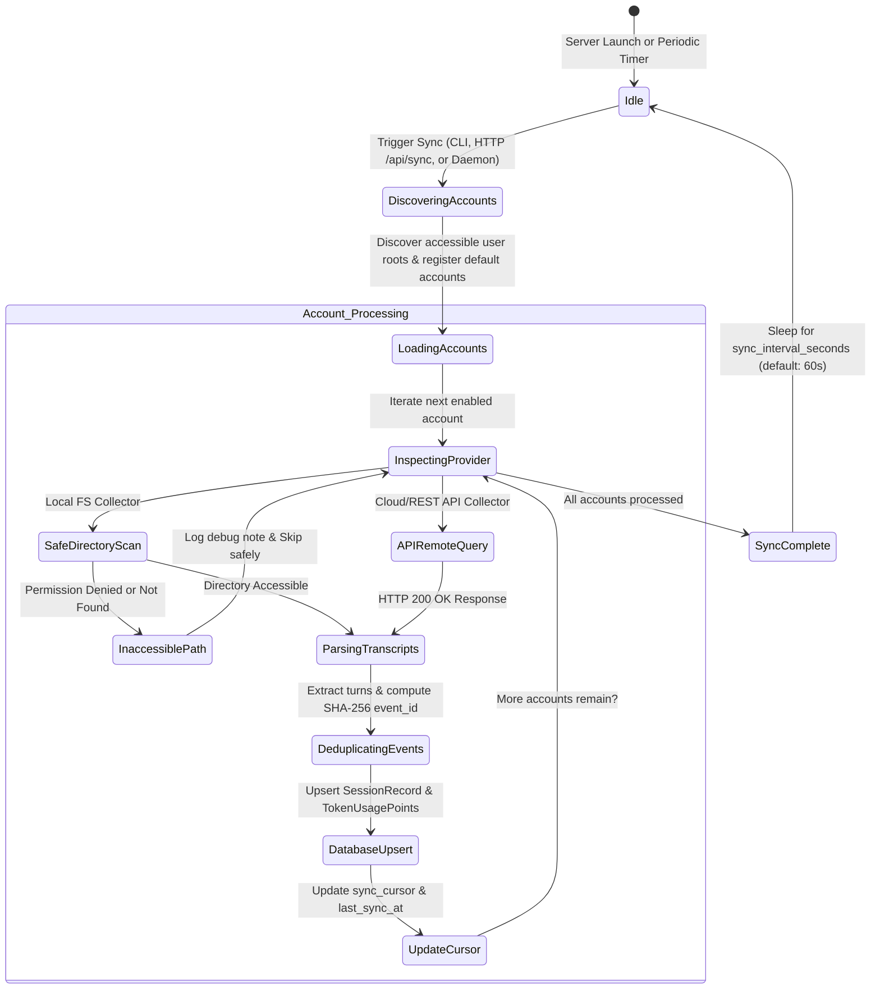
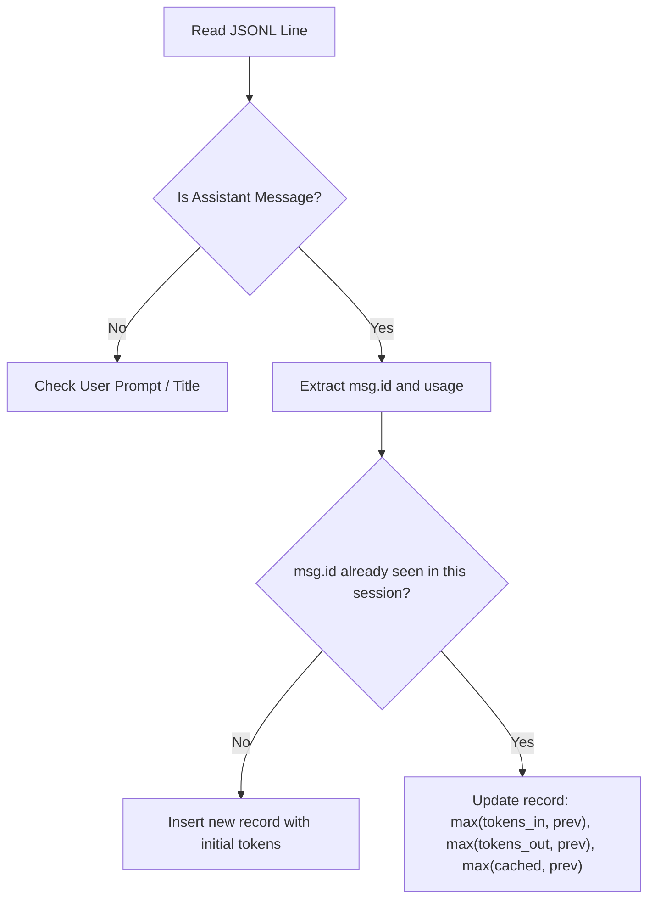

# Synchronization & Backfill Engine

The synchronization engine ([`SyncManager`](../development/api-reference.md)) coordinates multi-provider log ingestion, historical backfills, and incremental updates. It guarantees that telemetry data is deterministic, idempotent, and resilient to application restarts.

---

## Collector Lifecycle & Sync State Machine

The following state machine diagram illustrates the lifecycle of a synchronization cycle across enabled accounts.



---

## Deterministic Event Deduplication

Local agent transcripts are frequently appended to while a conversation is active. To prevent duplicate token counts when the sync engine sweeps files repeatedly, every turn receives a unique deterministic event hash.

### Event ID Calculation
The event ID is computed using SHA-256:

$$\text{event\_id} = \text{provider} + \text{"\_"} + \text{SHA256}(\text{provider} : \text{account\_id} : \text{session\_id} : \text{turn\_ref})[0:24]$$

```python
def make_event_id(provider: str, account_id: str, session_id: str, turn_ref: str) -> str:
    payload = f"{provider}:{account_id}:{session_id}:{turn_ref}"
    digest = hashlib.sha256(payload.encode("utf-8")).hexdigest()[:24]
    return f"{provider}_{digest}"
```

### Turn Reference Strategies by Provider

| Provider | Log Structure | Turn Reference (`turn_ref`) | Handling Streaming |
|---|---|---|---|
| **Antigravity** | `transcript.jsonl` | `step_{step_index}_{timestamp_iso}` | Discrete planner turns with unique `step_index`. |
| **Claude Code** | `projects/**/*.jsonl` | `message.id` or `line_{idx}_{timestamp}` | Message IDs remain stable across streaming chunks; highest token counts are retained. |
| **Codex** | `sessions/*.jsonl` | `turn_{turn_counter}_{timestamp}_{in}_{out}` | Differential token counter computes deltas between consecutive token_count events. |
| **Grok** | JSON or JSONL | `turn_{index}_{timestamp}` | Array index within conversation message list. |

---

## Handling Streaming and Cumulative Logs

### Claude Code Streaming Updates
Claude Code writes intermediate streaming events to disk while generation is in progress. The collector deduplicates these by message ID:



This guarantees that the final ingested turn reflects the complete, finalized token usage of the assistant's response.

### Codex Cumulative Rollouts
In OpenAI Codex CLI rollout files, `token_count` events report cumulative session totals (`total_token_usage`) rather than per-turn increments. The `CodexCollector` computes turn deltas:

$$\Delta T_{\text{in}} = \max(0, T_{\text{tot\_in}}^{(k)} - T_{\text{tot\_in}}^{(k-1)})$$
$$\Delta T_{\text{cached}} = \max(0, T_{\text{tot\_cached}}^{(k)} - T_{\text{tot\_cached}}^{(k-1)})$$
$$\Delta T_{\text{out}} = \max(0, T_{\text{tot\_out}}^{(k)} - T_{\text{tot\_out}}^{(k-1)})$$
$$T_{\text{uncached\_in}} = \max(0, \Delta T_{\text{in}} - \Delta T_{\text{cached}})$$

---

## Historical Ingestion & Offline Catch-Up

When the web dashboard is closed, developers continue prompting coding agents. The synchronization engine handles this through:

1. **Scheduled CLI Runs**: Invoking `monitor_agent_usage sync` via cron or a `systemd --user` timer.
2. **Startup Catch-Up**: Upon launching `monitor_agent_usage serve`, a full historical sync executes before binding the HTTP server.
3. **Session Metadata Continuity**: Existing sessions in the database are updated with updated `last_active_at` timestamps, latest workspace paths, and newly detected session titles without overwriting historical turns.
