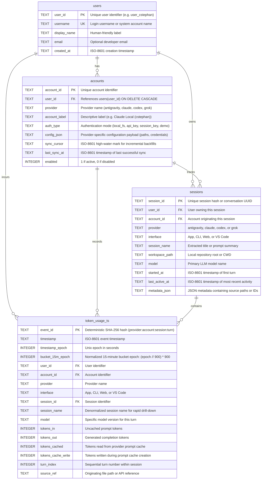

# Database Schema & Entity Relationships

The time-series database is powered by an embedded SQLite engine configured with Write-Ahead Logging (`WAL`), strict foreign keys, and normalized 15-minute epoch indexing.

---

## Entity-Relationship Diagram



---

## SQLite Table Definitions (DDL)

```sql
-- 1. Users Table
CREATE TABLE IF NOT EXISTS users (
    user_id TEXT PRIMARY KEY,
    username TEXT NOT NULL UNIQUE,
    display_name TEXT NOT NULL,
    email TEXT NOT NULL DEFAULT '',
    created_at TEXT NOT NULL
);

-- 2. Accounts Table
CREATE TABLE IF NOT EXISTS accounts (
    account_id TEXT PRIMARY KEY,
    user_id TEXT NOT NULL,
    provider TEXT NOT NULL,
    account_label TEXT NOT NULL,
    auth_type TEXT NOT NULL,
    config_json TEXT NOT NULL DEFAULT '{}',
    sync_cursor TEXT NOT NULL DEFAULT '',
    last_sync_at TEXT,
    enabled INTEGER NOT NULL DEFAULT 1,
    FOREIGN KEY (user_id) REFERENCES users(user_id) ON DELETE CASCADE
);

-- 3. Sessions Table
CREATE TABLE IF NOT EXISTS sessions (
    session_id TEXT PRIMARY KEY,
    user_id TEXT NOT NULL,
    account_id TEXT NOT NULL,
    provider TEXT NOT NULL,
    interface TEXT NOT NULL,
    session_name TEXT NOT NULL,
    workspace_path TEXT NOT NULL DEFAULT '',
    model TEXT NOT NULL DEFAULT '',
    started_at TEXT NOT NULL DEFAULT '',
    last_active_at TEXT NOT NULL DEFAULT '',
    metadata_json TEXT NOT NULL DEFAULT '{}'
);

-- 4. Time-Series Token Usage Table
CREATE TABLE IF NOT EXISTS token_usage_ts (
    event_id TEXT PRIMARY KEY,
    timestamp TEXT NOT NULL,
    timestamp_epoch INTEGER NOT NULL,
    bucket_15m_epoch INTEGER NOT NULL,
    user_id TEXT NOT NULL,
    account_id TEXT NOT NULL,
    provider TEXT NOT NULL,
    interface TEXT NOT NULL,
    session_id TEXT NOT NULL,
    session_name TEXT NOT NULL,
    model TEXT NOT NULL DEFAULT '',
    tokens_in INTEGER NOT NULL DEFAULT 0,
    tokens_out INTEGER NOT NULL DEFAULT 0,
    tokens_cached INTEGER NOT NULL DEFAULT 0,
    tokens_cache_write INTEGER NOT NULL DEFAULT 0,
    turn_index INTEGER NOT NULL DEFAULT 0,
    source_ref TEXT NOT NULL DEFAULT ''
);
```

---

## Indexing Strategy

To guarantee responsive rendering of the 15-minute time-series chart and instantaneous session drill-downs across hundreds of thousands of events, the database implements specialized composite indexes:

```sql
-- Optimizes 15-minute bucket aggregation grouped by bucket, provider, interface, and user
CREATE INDEX IF NOT EXISTS idx_ts_bucket_15m
    ON token_usage_ts(bucket_15m_epoch, provider, interface, user_id);

-- Accelerates global time window filters (last 24h, 7d, 30d bounds)
CREATE INDEX IF NOT EXISTS idx_ts_timestamp_epoch
    ON token_usage_ts(timestamp_epoch);

-- Accelerates turn-level timeline retrieval for individual sessions
CREATE INDEX IF NOT EXISTS idx_ts_session_id
    ON token_usage_ts(session_id, timestamp_epoch);

-- Speeds up session list queries filtered by provider, interface, and user
CREATE INDEX IF NOT EXISTS idx_sessions_lookup
    ON sessions(provider, interface, user_id, last_active_at);
```

### PRAGMA Settings
Upon opening a database connection, the engine executes:

```sql
PRAGMA journal_mode=WAL;
PRAGMA synchronous=NORMAL;
PRAGMA foreign_keys=ON;
```

- **`journal_mode=WAL`**: Enables concurrent reader connections to query telemetry while background sync threads write new turns.
- **`synchronous=NORMAL`**: Provides durability while removing filesystem sync bottlenecks on SQLite writes.
- **`foreign_keys=ON`**: Enforces relational consistency between users, accounts, and session data.

