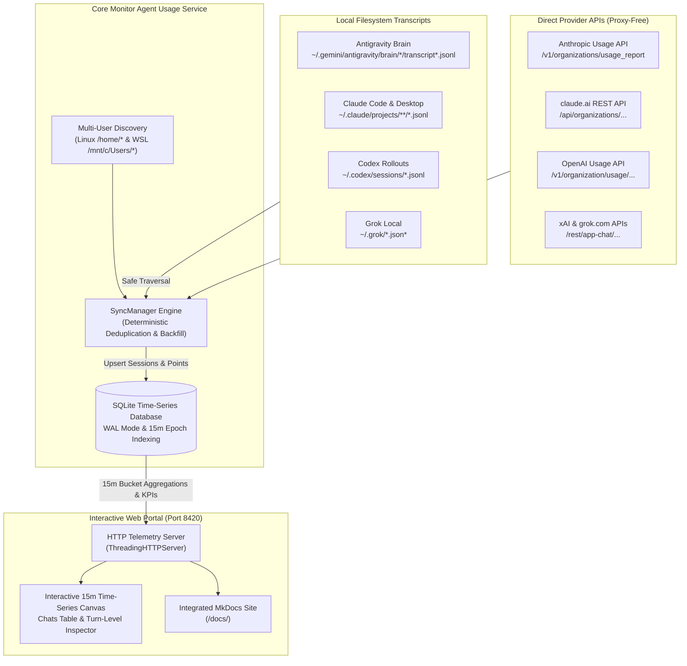

# Monitor Agent Usage

Welcome to the technical and developer documentation for **Monitor Agent Usage** — a proxy-free, multi-user, time-series token telemetry engine and interactive web portal for **Grok**, **Codex**, **Antigravity**, and **Claude** across Web, App, VS Code, and CLI surfaces.

[Open Historical Usage Portal](http://127.0.0.1:8420){ .md-button .md-button--primary }
[Architecture Overview](architecture/overview.md){ .md-button }
[Database Schema & Formulae](database/schema.md){ .md-button }

---

## What is Monitor Agent Usage?

Modern AI software development relies on multiple coding agents, interactive IDE extensions, CLI copilots, and provider web interfaces. However, tracking token consumption (including uncached input tokens, generation tokens, and prompt cache hits) is historically difficult:

1. **Proxy-based solutions introduce friction and risk**: Manually routing traffic through MITM proxies breaks TLS certificates, introduces latency, causes connection timeouts, and exposes confidential API keys and chat payloads.
2. **Coarse billing dashboards lack context**: Provider billing pages offer only delayed hourly or daily aggregates without turn-by-turn breakdowns, workspace paths, session titles, or IDE interface detection.
3. **Multi-user environments are neglected**: Engineering workstations and shared servers often host multiple developers and WSL distributions with independent agent session trees.

**Monitor Agent Usage** solves this by operating **100% proxy-free**: it passively parses local append-only transcripts and queries official provider REST APIs, normalizes all activity into deterministic 15-minute time-series buckets, and presents an interactive web portal for instantaneous drill-down analysis.

---

## High-Level Architecture

---

## Core Capabilities

| Feature | Description |
|---|---|
| **100% Proxy-Free** | Never intercepts or proxies network packets. Reads local transcripts and direct HTTPS endpoints safely. |
| **15-Minute Bucketized Graph** | Visualizes Tokens In, Tokens Out, and Cached Tokens in continuous 15-minute time slots. |
| **Interactive Block Drill-Down** | Clicking any 15-minute bar on the chart instantly filters the chat session table to chats active in that window. |
| **Interface Detection** | Automatically classifies activity into **App**, **CLI**, **Web**, or **VS Code**. |
| **Prompt Cache Economics** | Accurately calculates cache hit percentages ($T_{\text{cached}} / (T_{\text{in}} + T_{\text{cached}} + T_{\text{cwrite}})$). |
| **Multi-User & WSL Discovery** | Auto-discovers local Linux users and Windows host user directories in WSL with safe permission handling. |
| **Historical Ingestion While Closed** | Continuous background backfill and daemon sync via cron or systemd while the dashboard is closed. |

---

## Navigating This Documentation

- **[System Architecture](architecture/overview.md)**: Deep dive into the architectural tiers, data flow, and client interaction sequences.
- **[Synchronization Engine](architecture/sync-engine.md)**: State machines, deterministic SHA-256 deduplication, and historical backfills.
- **[Multi-User & Platform Discovery](architecture/multi-user-discovery.md)**: How the engine safely discovers and inspects multi-user directories without permission errors.
- **[Database Schema & Relationships](database/schema.md)**: Entity-relationship diagrams, SQLite table definitions, and index strategies.
- **[Queries & Data Retrieval](database/queries.md)**: Detailed breakdown of the exact SQL aggregation queries used by the dashboard.
- **[Statistical Formulae & Metrics](database/statistical-formulae.md)**: Mathematical formulations for 15-minute epoch bucketing, prompt cache hit ratios, and differential token counters.
- **[Interactive Web Dashboard](usage/web-dashboard.md)**: Step-by-step user guide for the telemetry UI and 15-minute block inspector.
- **[Historical Usage Portal](usage/portal.md)**: How the live dashboard integrates with this MkDocs site.
- **[Developer & Contributor Guide](development/getting-started.md)**: Local development setup using `.venv`, the `monitor_agent_usage` CLI, test suites, and writing custom collectors.

